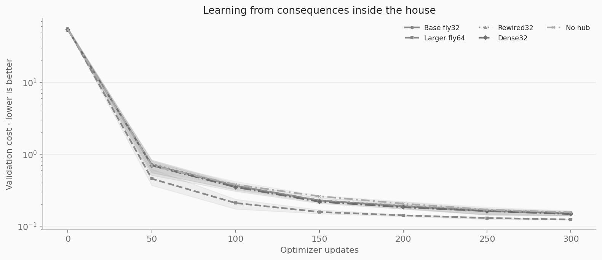
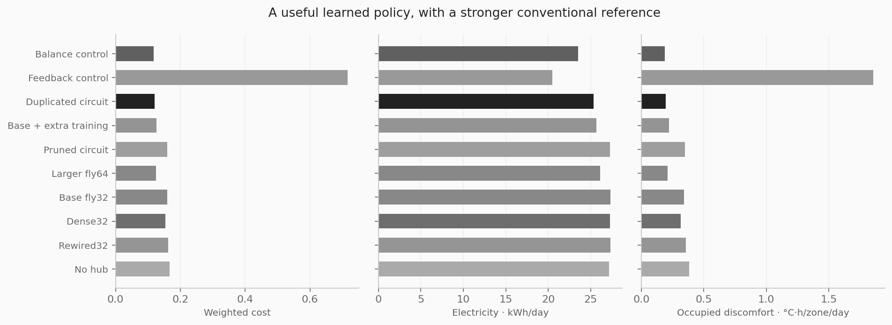
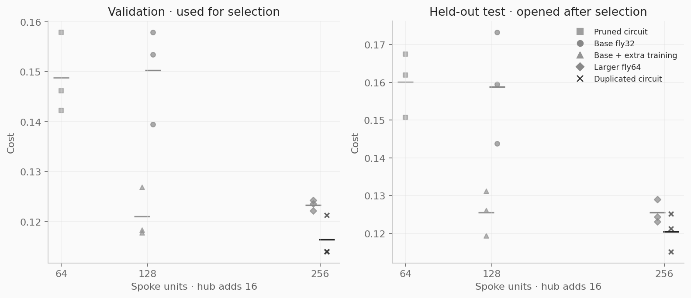
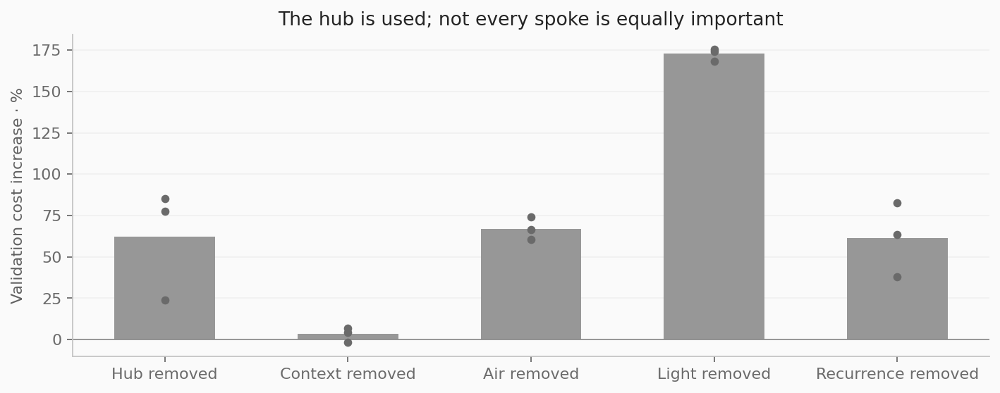
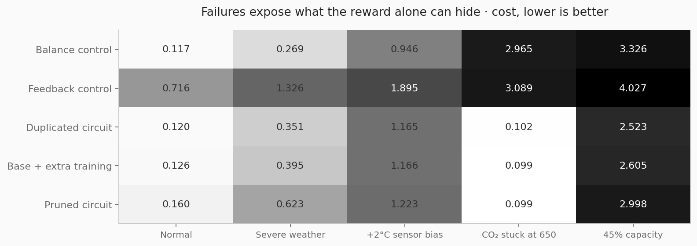
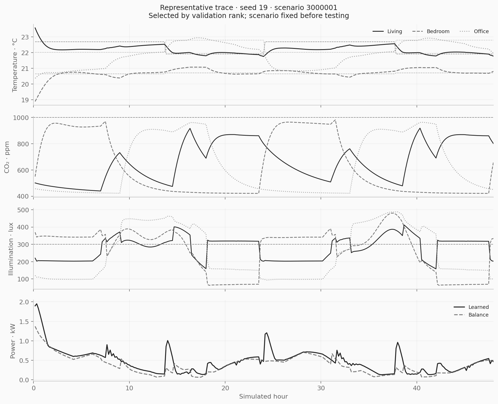
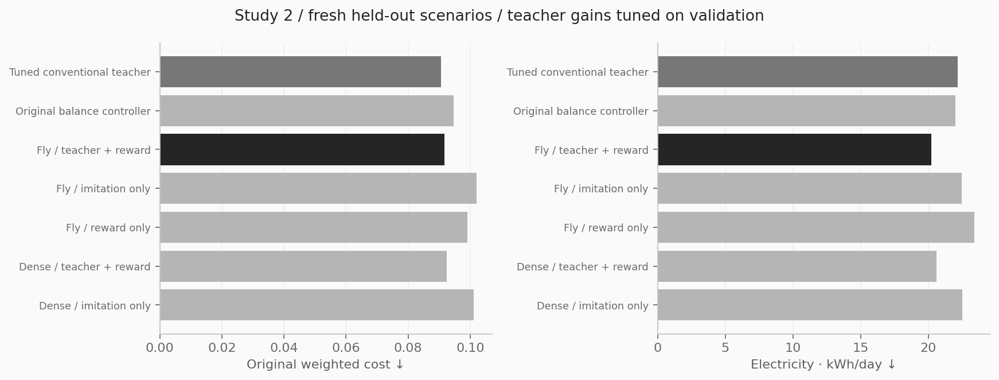
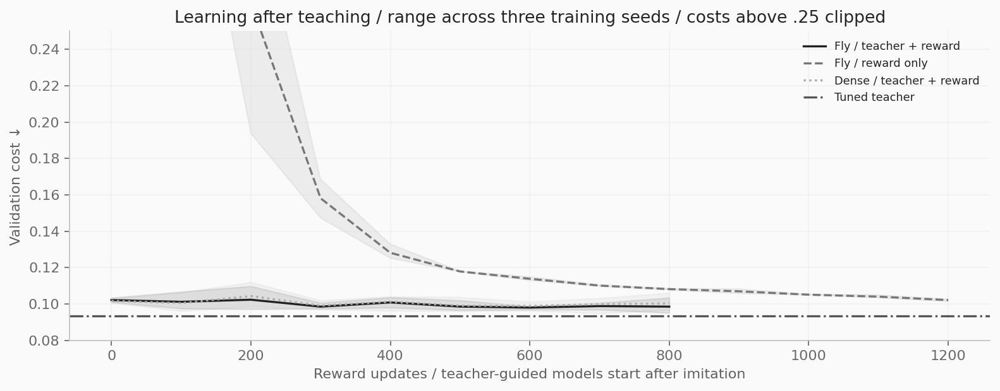

# SomaHouse: teaching a fly-derived circuit to regulate a home

Michael Wong · 22 October 2026 · Study 1

## Findings in plain terms

The controller learned to regulate a simulated three-room home. Doubling its functional spokes improved held-out cost by **4.1%** compared with giving the smaller circuit the same extra training. Cutting each spoke to half its cells made control worse. That makes duplication a useful result in this specific experiment, rather than a reason to assume that bigger biological circuits are always better.

The stronger conventional balance controller remained the better practical reference: lower average energy, less temperature discomfort and better CO₂ and light compliance. The learned controller used **7.7% more electricity** than that reference. Their aggregate cost difference was uncertain, and that aggregate conceals different comfort tradeoffs. Dense artificial wiring also outperformed the same-size fly-derived base. This study does not establish a special advantage from biological connectivity.

## Design and provenance

SomaHouse is isolated from FlyFi image compression: a separate repository, package, environment, server port, simulator, training runs and artifacts. Only a public, attributed connectome seed was copied. Image data and trained image models are not used.

The source is MaleCNS v1.0, attributed to FlyEM at HHMI Janelia, University of Cambridge, MRC LMB and Google Research, CC BY 4.0. The included 512-cell seed was previously extracted by connected greedy growth from a 5,609-cell learning-circuit annotation pool. Original source URLs and SHA-256 fingerprints, exact source IDs and extraction method are in data/connectome/provenance.json. This experiment uses nested 32- and 64-cell subsets, or salience-selected 16-cell descendants. These are not the complete fly brain, an unbiased anatomical sample, or all regions needed for biological behavior.

Each source subset initializes four independent artificial spokes: thermal, air, light and context. Sensor masks assign different observation streams. Every spoke sends an 8-number message to a learned 16-unit hub. The hub receives four concatenated domain ports and broadcasts back through private receive matrices, twice per decision. With duplicated spokes, messages are averaged within each domain, preserving four hub ports; split readouts sum the copies. Direct spoke-to-spoke links do not exist. The context spoke has no direct actuator head.

The selected model has **8 spokes × 32 cells = 256 spoke units**, plus 16 artificial hub units, **32 unique source cell IDs**, 4,952 masked recurrent edges and 23,833 allocated scalar parameters. All functional spokes already reuse the same source subset; doubling those spokes adds artificial copies, not newly observed source cells. Source GABA/glutamate labels give an initialization sign heuristic only; optimization can change weight signs. Tanh dynamics, adapters, hub and readouts are engineered. No electrophysiology is simulated. The term cortex is intentionally avoided: this hub is an engineering component.

The network is reactive between decisions. Its recurrent computation is internal to a decision, with two updates; the next decision observes current sensors and the previous executed action. It has no cross-step learned hidden state, no language model and no autonomous biological development.

## Physical model and assumptions

Three zones represent living, bedroom and office. The control interval is Δt = 1/6 hour. For zone i, temperature T, CO₂ concentration C, outdoor temperature To and action u:

```
ACH_i = 0.12 + 3.4 × vent_i
Q_i = G_i(To − T_i) + 0.000335 V_i ACH_i(To − T_i)
      + 0.025(mean(T) − T_i) + 0.12 people_i
      + 0.00035 daylight_i + 0.07 light_i + 3 heat_i
T_i(next) = T_i + Δt Q_i / heat_capacity_i
C_i(next) = C_i + Δt (18000 people_i / V_i − ACH_i(C_i − 420))
lux_i = daylight_i + 450 light_i
power = sum_i(3 abs(heat_i)/3.2 + 0.045 vent_i³ + 0.07 light_i)
```

Heat is signed for heating or cooling, bounded to ±3 kW per zone and a shared 6 kW thermal limit. The fixed assumed heat-pump COP is 3.2. Vent and light fractions are 0–1. The equipment-off control has passive infiltration and no electrical use; standby and fan energy for that passive infiltration are not modeled. Reduced-capacity stress scales HVAC and vent capacity to 45%, leaving lights unchanged. Interzone heat exchange is symmetric, while interzone CO₂ transfer is not modeled.

Per-scenario heat capacity varies 1.3–2.2 kWh/K, envelope conductance 0.055–0.095 kW/K and room volume 65–100 m³. Three equally sampled synthetic seasons have average outdoor temperatures near 3, 17 and 31°C with daily waves and correlated disturbances. Daylight follows a day/night curve with time-varying cloud modulation. Occupancy schedules vary in timing and include visits. Temperature targets vary by room and shift after a randomized daytime point. Initial temperatures are within ±2.5°C of target; initial CO₂ is 450–1,100 ppm. These are plausible toy-system assumptions, not a calibrated house or real weather dataset.

Current observations contain temperature, CO₂, illumination, people, targets, daylight, outdoor temperature, time-of-day, previous actions and a synthetic time-of-use price multiplier. No controller sees future weather or occupancy. Neural controllers do not receive randomized true plant parameters. Conventional balance control uses fixed nominal parameters (82 m³, 0.075 kW/K and a nominal tracking gain); its model-based engineering knowledge is an explicit advantage. This is not a compute- or information-prior-matched comparison against an optimized MPC system.

## Training, reward and selection

Training uses analytical gradients through the differentiable simulator to minimize multi-step control cost. It starts with random adapters and source-initialized recurrent weights; no imitation targets are supplied. This is model-based policy learning, not model-free PPO or evidence of autonomous online learning. Knowing simulator derivatives substantially simplifies learning.

Per-step cost is the mean across three rooms of 4 × occupied temperature slack², 0.4 × empty-room temperature slack², 0.05 × occupied tracking error², 2 × occupied (CO₂ excess/500)² and 4 × occupied (light deficit/300)², plus 0.08 × electrical kW × price and 0.012 × mean absolute action movement. Occupied thermal slack starts outside ±1°C; empty-room slack outside ±3°C. CO₂ excess starts at 1,000 ppm and light deficit below 300 lux. These are engineering targets, not universal health or comfort standards. Soft penalties permit violations; no hard safety guarantee is imposed. This matters for interpreting the CO₂ result.

Three training seeds (7, 19, 41) each trained five base architectures for 300 updates: fly32, fly64, degree-preserving rewired32, dense32 and nohub32. All got the same exogenous training draws per seed and optimizer schedule. Each update used 24 independently generated four-hour windows, starting at randomized times and states; truncated windows are not complete day episodes. Adam learning rate was 0.003, gradients clipped at norm 5.

Each trained fly32 produced continue, cut and duplicate descendants, each receiving 150 additional updates at learning rate 0.0015 and matched draws. Pruning uses combined input/readout/send/receive weight salience averaged across modules to retain 16 source IDs; actual tensors are compacted. This heuristic is not a search for optimal anatomical regions. Duplication initially preserves actions through mean hub pooling and split readouts; small input perturbations then break copy symmetry. Continue supplies the equal-extra-training control. Comparing duplication only to the 300-update base would confound more training and more capacity.

The total is **24 trained candidates, 5,850 optimizer updates, 140,400 windows and 3,369,600 training transitions**, plus validation rollouts. Summed run time was 4.7 minutes on an M1 Max with 32 GiB, CPU, two PyTorch threads. Validation used 24 fixed independent 24-hour scenarios, at update 0, every 50 updates and the final update. Each candidate retains its lowest-cost validation checkpoint, including step zero if needed. Initial and selected checkpoints are saved.

Training, validation, primary test and stress seeds occupy disjoint ranges. The committed protocol predates training; selection was committed at Git revision 4e527ee before test evaluation. The primary family was selected from fly32, fly64, continue, cut and duplicate by mean validation cost, preferring fewer units within 2% of the best. Duplication additionally had to improve all three validation seeds. It met those conditions: validation mean 0.11644 versus 0.12101 for continue. A held-out paired interval also had to exclude zero before a duplication benefit could be claimed. No test-based tuning followed.



## Held-out results

The primary set contains 60 independent 48-hour scenarios. Learned families each contribute 180 episodes across three training seeds. Conventional policies each contribute 60 episodes. Four stress families add 16 independent scenario seeds each; stress seeds are reused across shifts for pairing. Across 30 policy instances, the evaluation contains **3,720 episodes and 1,071,360 transitions**. These cover 76 unique exogenous seed IDs and 124 scenario/shift combinations; they are not 3,720 independent buildings.

Daily metrics divide 48-hour totals by two. Temperature, CO₂ and light deficits are integrated over occupied zones then divided by all three zones, not only occupied zones; compliance fractions use occupied zone-hours. Means of scenario compliance fractions are reported. Light compliance permits a 5-lux numerical/practical margin (≥295 lux), while deficit remains measured below 300 lux. That margin was present in the simulator before training. The weighted objective includes unoccupied drift, price and movement, so it cannot be reconstructed from the daily occupied deficits alone.

| Controller | Cost ↓ | kWh/day ↓ | °C·h/zone/day ↓ | CO₂ ppm·h/zone/day ↓ | Light lux·h/zone/day ↓ | Temp / CO₂ / light compliance |
|---|---:|---:|---:|---:|---:|---|
| Balance control | 0.1172 | 23.52 | 0.189 | 0.04 | 0.00 | 95.3% / 100.0% / 100.0% |
| Feedback control | 0.7157 | 20.50 | 1.857 | 0.09 | 0.00 | 79.4% / 99.9% / 100.0% |
| Duplicated circuit | 0.1205 | 25.32 | 0.196 | 40.06 | 3.77 | 92.7% / 91.0% / 98.0% |
| Base + extra training | 0.1256 | 25.65 | 0.221 | 47.39 | 4.56 | 92.2% / 89.1% / 97.6% |
| Pruned circuit | 0.1601 | 27.28 | 0.349 | 107.32 | 4.92 | 91.0% / 82.9% / 97.6% |
| Larger fly64 | 0.1255 | 26.12 | 0.209 | 35.57 | 5.45 | 93.3% / 91.2% / 97.2% |
| Base fly32 | 0.1589 | 27.32 | 0.340 | 99.04 | 7.44 | 91.1% / 83.5% / 96.1% |
| Dense32 | 0.1538 | 27.27 | 0.316 | 96.62 | 7.31 | 91.6% / 83.2% / 96.3% |
| Rewired32 | 0.1622 | 27.30 | 0.355 | 100.07 | 8.01 | 90.9% / 83.2% / 95.7% |
| No hub | 0.1671 | 27.14 | 0.384 | 88.23 | 5.72 | 90.7% / 81.4% / 97.4% |
| Untrained circuit | 106.5196 | 4.34 | 54.872 | 6.02 | 730.37 | 8.9% / 97.1% / 39.9% |
| Equipment off | 97.6220 | 0.00 | 51.123 | 6149.95 | 1528.29 | 9.5% / 15.9% / 25.7% |



The selected duplicated controller reaches **92.7% temperature, 91.0% CO₂ and 98.0% light compliance**, compared with 95.3%, 99.97% and 100.0% for balance control. Daily energy is 25.32 versus 23.52 kWh. It beats the proportional feedback baseline on weighted cost and thermal regulation, while spending more electricity and allowing more CO₂ excess. These are tradeoffs, not blanket energy savings.

## Capacity, topology and uncertainty

The matched duplication gain is 4.07%. Its paired scenario cost interval excludes zero. Pruning increases mean cost by 27.5% versus continue, despite fewer parameters. The larger 64-cell source subset and the duplicated 32-cell subset both have 256 spoke units but differ in unique cells and training schedule; they do not isolate anatomy alone.

| A minus B, cost | Mean difference | Paired scenario 95% interval |
|---|---:|---|
| Duplicated circuit − Feedback control | -0.59524 | [-0.83109, -0.37594] |
| Duplicated circuit − Balance control | +0.00331 | [-0.00395, +0.00926] |
| Duplicated circuit − Base + extra training | -0.00510 | [-0.00797, -0.00289] |
| Pruned circuit − Base + extra training | +0.03450 | [+0.01941, +0.05187] |
| Base fly32 − Rewired32 | -0.00330 | [-0.00644, -0.00076] |
| Base fly32 − Dense32 | +0.00507 | [+0.00196, +0.00841] |
| Base fly32 − No hub | -0.00824 | [-0.01561, -0.00187] |
| Base fly32 − Untrained circuit | -106.36076 | [-128.48117, -84.82037] |


Intervals use 2,000 paired bootstrap resamples over the 60 test scenarios after averaging training seeds, with bootstrap seed 918. Negative means A is lower-cost. The training seeds are treated as three fixed replicates, so these intervals understate uncertainty about arbitrary retraining. All per-seed outcomes are below. Controls are predeclared; the secondary comparison intervals are not adjusted for multiple testing. A significant fly-versus-rewired difference is small and does not prove a general connectome advantage, especially because dense wiring does better and has more active edges. Dense and fly controls have the same allocated tensor dimensions; the random control preserves exact directed in/out degrees through double-edge swaps, not merely a node permutation.



| Family | Seed | Selected update | Validation cost | Test cost |
|---|---:|---:|---:|---:|
| fly32 | 7 | 300 | 0.15790 | 0.17335 |
| fly64 | 7 | 300 | 0.12356 | 0.12436 |
| rewired32 | 7 | 300 | 0.16162 | 0.17928 |
| dense32 | 7 | 300 | 0.15380 | 0.16708 |
| nohub32 | 7 | 300 | 0.16144 | 0.18045 |
| continue | 7 | 150 | 0.12685 | 0.13116 |
| cut | 7 | 150 | 0.15794 | 0.16199 |
| duplicate | 7 | 150 | 0.12132 | 0.12514 |
| fly32 | 19 | 300 | 0.15341 | 0.15950 |
| fly64 | 19 | 300 | 0.12216 | 0.12314 |
| rewired32 | 19 | 300 | 0.15793 | 0.16206 |
| dense32 | 19 | 300 | 0.14878 | 0.15279 |
| nohub32 | 19 | 300 | 0.16309 | 0.17562 |
| continue | 19 | 150 | 0.11836 | 0.12612 |
| cut | 19 | 150 | 0.14622 | 0.16749 |
| duplicate | 19 | 150 | 0.11407 | 0.12119 |
| fly32 | 41 | 300 | 0.13947 | 0.14374 |
| fly64 | 41 | 250 | 0.12429 | 0.12895 |
| rewired32 | 41 | 300 | 0.14084 | 0.14514 |
| dense32 | 41 | 300 | 0.13838 | 0.14150 |
| nohub32 | 41 | 300 | 0.14048 | 0.14523 |
| continue | 41 | 150 | 0.11780 | 0.11943 |
| cut | 41 | 150 | 0.14226 | 0.15073 |
| duplicate | 41 | 150 | 0.11393 | 0.11506 |


## What communication and lesions reveal

Zeroing hub output, a functional spoke, recurrence, or a source cell class is a post-hoc validation intervention; no lesion is retrained. Hub removal raises cost in all three selected models. The context spoke has a small and inconsistent effect, including one slight improvement when removed; this module is a candidate for future retraining/pruning, not a proven necessary component. Thermal lesions are catastrophic because the thermal head loses its learned state. Air, light and recurrence lesions worsen performance. Source class lesions mainly identify where this engineered task's computation ended up, not what those cells do in a fly.



| Source class lesion | Intact mean validation cost | Lesioned mean cost | Interpretation |
|---|---:|---:|---|
| DAN | 0.1164 | 0.1269 | Computational lesion; no claim about fly behavior |
| Kenyon_Cell | 0.1164 | 3.9939 | Computational lesion; no claim about fly behavior |
| MBON | 0.1164 | 0.4667 | Computational lesion; no claim about fly behavior |
| Unclassified | 0.1164 | 0.1400 | Computational lesion; no claim about fly behavior |


## Robustness and failure modes

| Shift | Controller | Cost | kWh/day | Temperature compliance | CO₂ compliance |
|---|---|---:|---:|---:|---:|
| weather | Balance control | 0.269 | 25.70 | 91.2% | 100.0% |
| weather | Duplicated circuit | 0.351 | 28.01 | 79.6% | 90.1% |
| temperature_bias | Balance control | 0.946 | 18.38 | 6.9% | 100.0% |
| temperature_bias | Duplicated circuit | 1.165 | 20.02 | 4.5% | 92.7% |
| co2_dropout | Balance control | 2.965 | 16.77 | 98.3% | 14.4% |
| co2_dropout | Duplicated circuit | 0.102 | 19.51 | 98.5% | 63.2% |
| capacity | Balance control | 3.326 | 12.17 | 55.8% | 27.8% |
| capacity | Duplicated circuit | 2.523 | 15.07 | 66.0% | 41.3% |


Sensor bias is a major failure: temperature compliance collapses for both controllers. Reduced equipment capacity exposes physical limits; learned control has a lower aggregate penalty here, but still violates targets substantially. Under a CO₂ sensor stuck at 650 ppm, the learned objective can improve despite worse CO₂ compliance because the soft aggregate trades ventilation and thermal/energy costs. This is a concrete example of why a reward reduction is insufficient evidence of acceptable home control. No fault detector, redundant sensing or independently enforced safety supervisor exists in this prototype.





## Timing, verification and reproducibility

Median batch-one learned inference is approximately **0.198 ms** on this CPU; balance control is approximately 0.080 ms. Timing uses 20 warmups and 200 measured calls per trained instance; it excludes sensors, networking, physics integration and actuators. A ten-minute simulated control interval is not a measured real-home reaction time. The source wiring supplies no demonstrated speed advantage. Masked dense recurrent tensors mean fewer active edges do not necessarily run faster.

Independent checks read all **48 initial/selected checkpoint files**, verified hashes and finite tensors, confirmed changes to active recurrent weights, and obtained identical actions after save/reload. All **180 primary held-out episodes** were replayed with exact recorded metrics on the training machine. A separate float64 NumPy implementation replayed four 48-hour traces (**1,152 steps**) and independently integrated temperature, CO₂, illumination, energy and deficits within declared tolerances. Simulator tests cover passive equilibrium, known CO₂ decay, heat capacity, energy integration, finite-difference derivatives, actuator bounds, reproducibility, graph degrees, hub isolation, surgery and API behavior. The initial evaluation hit an unclassified-cell metadata sorting error after scoring; only class-label handling was repaired, then the same frozen models/scenarios were reevaluated. A later review corrected functional-spoke lesions to silence the first message as well as subsequent updates; only validation interventions were recomputed. A regression test proves that a lesioned spoke cannot transmit its unique sensor input. The result metadata records the unchanged score hash. No trained weights, primary/stress scores, selection or reward were changed.

Run `uv sync --extra test`, `uv run --no-sync python -m pytest -q`, `uv run --no-sync python -m somahouse.verify`, then `uv run --no-sync python -m somahouse.app --port 8766`. Existing results are protected from training overwrite. To reproduce training in a fresh checkout, first move reports/ and checkpoints/ to an archive outside the checkout, recreate those directories, and run `python -m somahouse.study train` followed by `evaluate`, `verify` and `report` through uv. Preserve the included source seed and protocol. The exact environment is pinned in uv.lock. Different hardware/library builds may change training numerics.

The live lab runs inference with saved weights. Setpoint, occupancy, daylight, weather, sensor stress and hub/spoke interventions affect only an in-memory session. They are not additional research observations and do not update the trained model. The architecture inspector reads actual weights, source identifiers and surgery lineage. Downloadable artifacts include episode CSV, selection, checkpoints, protocol, verification and the study bundle. The portable docs/ case study works without a Python backend; the interactive house requires the local server.

## Limits and next experiment

This is a finite-budget proof of concept in one generator. Three seeds and 60 normal scenarios are limited. Synthetic schedules, fixed COP, simplified radiation and air mixing, no humidity, particulates, equipment delay, noisy communications, true weather records or human preference model restrict relevance. A high-order building emulator and a well-tuned PID/MPC reference are needed before external control claims. No hardware has been connected.

The study explores explicit training and structural operations, not open-ended self-evolution. One duplication and one salience pruning operation are tested per seed; no automatic invention of arbitrary wiring or lifelong adaptation is demonstrated. Circuit necessity is not established by a lesion alone. Future work should preregister a new held-out set, replace soft CO₂ and comfort penalties with constrained control, add sensor-fault handling, retrain without the weak context spoke, and evaluate on a calibrated BOPTEST/EnergyPlus building with matched sensor access. Online adaptation would then need a bounded rollback and independent constraints.

## Primary references and licenses

- [MaleCNS download, attribution and CC BY 4.0](https://male-cns.janelia.org/download/)
- [Google Research: male fruit fly connectome](https://research.google/blog/a-connectomics-milestone-mapping-the-complete-male-fruit-fly-brain/)
- [EnergyPlus engineering zone heat-balance reference](https://energyplus.readthedocs.io/en/stable/guides/engineering-reference/2.1-basis-for-the-zone-and-air-system-integration.html)
- [BOPTEST core KPI definitions](https://ibpsa.github.io/project1-boptest/docs-design/core_kpi.html)
- [PODS: Policy Optimization via Differentiable Simulation](https://proceedings.mlr.press/v139/mora21a.html)

EnergyPlus and BOPTEST inform the physical balance and separate-metric methodology; this custom simulator has not been validated against either framework. Code is MIT; source/derived connectome data and trained checkpoints retain CC BY 4.0 attribution. Font licenses are bundled.


---

# Study 2 — can a teacher help the circuit surpass conventional control?

The student did not pass the registered superiority test. The student has 1.34% higher cost than the tuned teacher and uses 8.76% less electricity. It meets fewer occupied temperature and CO₂ targets. Teaching plus refinement lowers cost 7.45% versus reward-only training and 10.05% versus imitation alone. These are new models and new test scenarios; study-1 scores remain unchanged.

## Why I added this experiment

The first experiment learned useful control but did not beat its strongest conventional reference. I wanted to see whether teaching the circuit good actions first, then letting it optimize their consequences, could close that gap. I also made the conventional reference stronger. Beating the weaker old reference would not answer whether the student can surpass the teacher it learned from.

The plan in research/teacher-protocol.md was committed before training (89a8294). The primary family was fixed as fly teacher + reward. Teacher gains, checkpoint hashes and median-validation representative seed were sealed in commit 9bfad28 before opening final tests. No hyperparameters, scored cost weights or checkpoints were changed after those tests. Original report scores and training artifacts were preserved.

## Teacher, student and information access

The conventional teacher is the lowest validation-cost controller among 36 nominal heat/air-balance gain combinations and the original balance baseline. The grid tests thermal gain 0.65/1.3/2.0, occupied offset 0/0.4/0.75°C toward outdoors, CO₂ target 850/950 ppm and ventilation feedback factor 0.6/1.2. Selected parameters: `{"co2_target": 950.0, "gain": 2.0, "offset": 0.0, "vent_gain": 1.2}`. Validation cost: 0.09353. It uses fixed nominal building constants, current sensors and previous actions, no future schedules or true randomized plant parameters. This is a limited tuned conventional family, not an optimized MPC benchmark.

Every neural family uses eight 32-cell private spokes and the same learned 16-unit hub: 256 spoke units plus the hub. Fly masks retain 32 unique MaleCNS source identifiers; copies increase artificial units, not source diversity. Dense controls have the same allocated tensor dimensions with more active recurrent edges. All neural outputs come from the saved standalone network. The teacher is absent at inference; no thermostat overlay or teacher correction rescues neural actions. The source topology, artificial hub, engineered sensor assignments and tanh units have the same biological-fidelity limits as study 1.

## Teaching and reward feedback

For seeds 107, 119 and 141, collect 1,024 training episodes of 24 steps under the teacher, then train on 512 observation/action pairs per update for 400 Adam updates at .003. The target is the teacher's executed actuator command. Supervised loss is mean squared action error with light components weighted four. At update 200, add 256 twelve-step student-driven episodes with teacher action labels. This counters the shift between teacher and student states. It resembles teaching on student-visited states, but is not presented as a full DAgger implementation.

The selected imitation checkpoint starts 800 reward updates at Adam .001. Each update rolls 32 independent eight-hour windows, 48 ten-minute decisions, with direct gradients through the simulator. Gradient norms are clipped to five. The original scored cost is retained, with two additional declared training regularizers: occupied CO₂ excess above 950 ppm, weight 0.5 on normalized squared excess, and occupied light deficit below 300 lux, weight 2. These soft regularizers do not guarantee constraint satisfaction. Validation and test selection use the original cost only.

Controls retain the imitation-only checkpoint, train the same initial fly model with 1,200 reward-only updates, and repeat imitation + reward with dense wiring. Fly/dense imitation has 400 supervised updates; refinement has 800 simulated updates; reward-only has 1,200 simulated updates. Equal optimizer counts do not mean equal compute or interaction budget: supervised steps are cheaper and reward-only observes more transitions. Comparing final teacher + reward to its own imitation parent isolates refinement; comparing fly versus dense helps check whether source wiring is responsible.

Total: 15 selected stage checkpoints, six initial checkpoints, 10,800 optimizer updates, 1,228,800 supervised pair presentations, and 13,068,288 training/data-collection transitions. Reward optimization contributes 12,902,400 transitions. Summed recorded training time is 14.77 minutes on the same M1 Max CPU, two PyTorch threads; initial teacher-dataset collection and conventional grid search are outside stage timing. Validation occurs at step zero and every 100 updates, retaining the lowest original validation cost including step zero.

## Fresh evaluation and uncertainty

Training scenario IDs are 5,000,000–5,999,999. Validation uses 32 independent 48-hour IDs 6,000,001–6,000,032; final test uses 100 IDs 7,000,001–7,000,100. Four fault shifts each reuse 24 IDs 8,000,001–8,000,024 for pairing. No ID overlaps study 1's validation or final sets. These are new samples from the same synthetic generator, not a new building simulator or external validation dataset.

3,332 evaluated policy episodes / 959,616 transitions arise from 17 policy instances and 196 scenario/shift pairs; only 124 unique exogenous seed IDs exist. Neural family means average three training seeds. Conventional controls run once per scenario. Paired intervals use 5,000 resamples of 100 normal scenario IDs, RNG seed 1907, after averaging training seeds. Retraining uncertainty and multiple-comparison correction are absent; secondary comparisons are descriptive.

|Controller|Cost ↓|kWh/day ↓|Temperature|CO₂|Light|
|---|---:|---:|---:|---:|---:|
|Tuned conventional teacher|0.09052|22.150|98.06%|99.83%|100.00%|
|Original balance controller|0.09469|22.005|96.86%|99.72%|100.00%|
|Fly / teacher + reward|0.09173|20.210|96.08%|95.47%|99.02%|
|Fly / imitation only|0.10199|22.467|96.34%|84.55%|78.84%|
|Fly / reward only|0.09911|23.380|96.30%|96.09%|98.42%|
|Dense / teacher + reward|0.09243|20.584|95.98%|96.70%|98.72%|
|Dense / imitation only|0.10110|22.517|96.47%|86.48%|82.47%|


Daily energy divides 48-hour totals by two. Compliance is the mean occupied-time fraction per scenario: temperature within ±1°C, CO₂ ≤1,000 ppm, light ≥295 lux. Full occupied deficit integrals, action movement and peak power are in episodes.csv. All controllers receive identical current observations and actuator constraints. Aggregate cost cannot alone demonstrate safe or uniformly better control.



## Registered superiority gates

The primary claim requires at least 2% lower mean cost; paired cost interval below zero; lower cost in all three training seeds; lower paired confidence bound on each compliance difference above -1 percentage point; and upper paired energy-increase bound below 2% of teacher mean energy. Every condition must pass. These are practical non-inferiority margins selected before training, not post-hoc excuses for a lower reward.

- FAIL — Cost at least 2% lower
- FAIL — Cost advantage supported by the uncertainty interval
- FAIL — Lower cost in all three training seeds
- PASS — Electricity within the 2% tolerance
- FAIL — Temperature compliance within one percentage point
- FAIL — CO₂ compliance within one percentage point
- FAIL — Lighting compliance within one percentage point

|Metric: student minus teacher|Mean difference|Paired 95% interval|
|---|---:|---|
|cost|+0.00121|[-0.00197, +0.00497]|
|energy_kwh|-3.88046|[-4.22267, -3.56115]|
|thermal_compliance (percentage points)|-1.97673|[-2.60133, -1.40011]|
|co2_compliance (percentage points)|-4.35374|[-5.77986, -3.06560]|
|light_compliance (percentage points)|-0.98326|[-1.27014, -0.73040]|


Individual primary costs: seed 107: 0.09144, seed 119: 0.09221, seed 141: 0.09155. Full trajectories and dense/reward-only controls are retained even when they weaken a preferred explanation. A win over the original balance baseline does not establish a win over the tuned teacher. A dense model matching or beating the fly model does not establish a connectome advantage.



## Stress results

|Fault|Teacher cost|Fly teacher + reward cost|Teacher temperature / CO₂|Fly temperature / CO₂|
|---|---:|---:|---|---|
|weather|0.6871|0.8048|86.1% / 99.9%|76.7% / 88.0%|
|temperature_bias|1.1618|1.3070|2.9% / 99.9%|4.1% / 96.8%|
|co2_dropout|2.5935|0.5286|98.5% / 15.9%|97.0% / 26.2%|
|capacity|5.0532|4.7175|48.0% / 29.9%|43.7% / 27.5%|

Stress results are descriptive and do not select checkpoints. Sensor bias, dropout and capacity limits can defeat both designs. Simulation reward refinement is not a substitute for redundant sensors, calibrated plant identification, independent limits or real-building trials. No physical house was controlled and no claim of safe deployment is made.

## Readback, reproducibility and next question

Run `python -m somahouse.teacher_verify` to verify selected checkpoint hashes, exact save/reload actions, finite tensors, changes to active recurrent weights, all 1,700 normal controller episodes, comparison intervals and two independently integrated NumPy traces. `--portable` permits the same unit-aware CPU rounding tolerances as study 1. See verification.json for actual outcomes. The live inspector can load all saved study-2 models. Page interaction and video playback never update their weights.

For reproduction in a separate checkout, archive reports/teacher and checkpoints/teacher outside that checkout; run `python -m somahouse.teacher train`, commit the sealed selection, then `evaluate`, `somahouse.teacher_verify` and `somahouse.report`. Completed evaluation is protected from overwrite. The original physics, source seed, versions and scored reward remain pinned. Hardware differences can change training numerics.

The useful next question is whether a controller with better identification of the house and explicit constraints can improve the energy/comfort tradeoff on a calibrated external building model. More copies alone are not evidence of better control. Teacher-guided training can be assessed without claiming that the artificial fly circuit is biologically intelligent or universally better than conventional engineering.

Method references: [Policy Optimization with Demonstrations](https://proceedings.mlr.press/v80/kang18a.html), [Policy Optimization via Differentiable Simulation](https://proceedings.mlr.press/v139/mora21a.html). These provide methodological context; this implementation is independent supervised imitation plus differentiable policy optimization, not model-free RL or either published algorithm. MaleCNS attribution and CC BY 4.0 carry over to derived data and checkpoints; original code/report remain MIT.


## Secondary cost comparisons

Student minus reference; negative favors the teacher-guided fly model. These comparisons were declared, but are secondary and not corrected for multiple testing.

|Reference|Cost difference|Paired 95% interval|
|---|---:|---|
|Original balance controller|-0.002959|[-0.006720, +0.000978]|
|Fly / imitation only|-0.010254|[-0.013947, -0.006465]|
|Fly / reward only|-0.007383|[-0.010274, -0.003905]|
|Dense / teacher + reward|-0.000701|[-0.001568, +0.000350]|


## Supervision diagnostic

Unweighted executed-action mean squared error on the 32 validation teacher trajectories. This evaluates copying on teacher-visited states, not closed-loop performance, and was not used to change selected checkpoints.

|Family|Seed 107|Seed 119|Seed 141|
|---|---:|---:|---:|
|Fly / imitation only|0.001269|0.001298|0.001259|
|Fly / teacher + reward|0.023766|0.023345|0.019992|
|Fly / reward only|0.034807|0.053410|0.036526|
|Dense / imitation only|0.001229|0.001297|0.001029|
|Dense / teacher + reward|0.023200|0.024664|0.006322|

Readback passed: 15 selected models, 6 initial models, 1,700 normal policy episodes, 576 independent NumPy physical steps, and all 9 comparison intervals recomputed from episode CSV. Mode: strict_1e-7.
